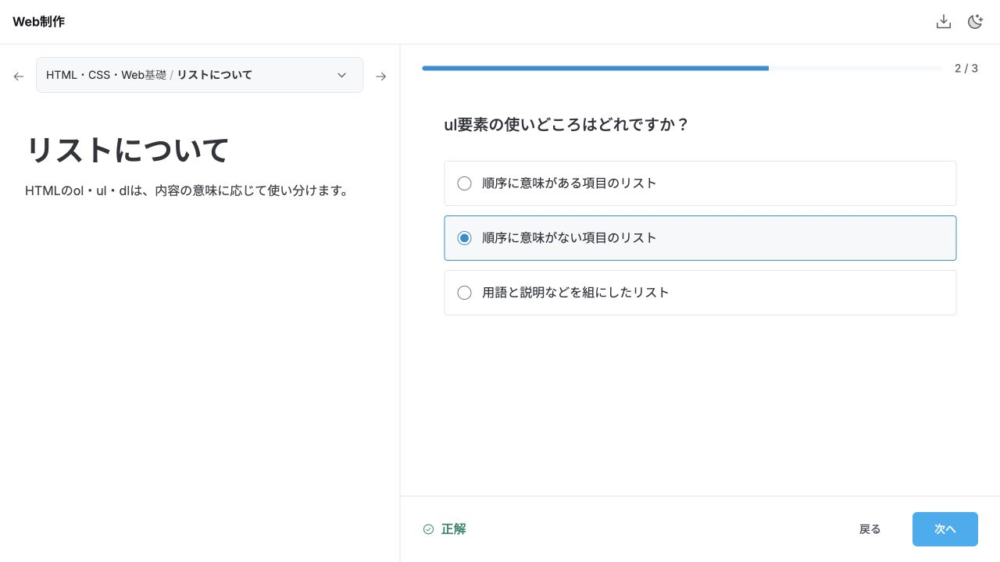
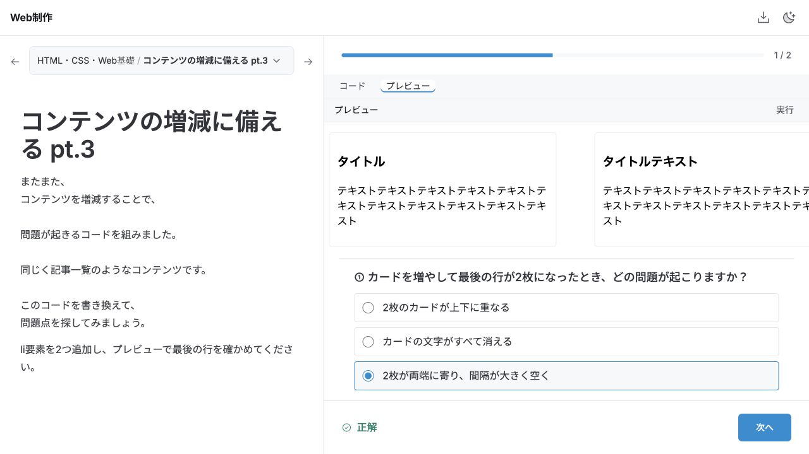
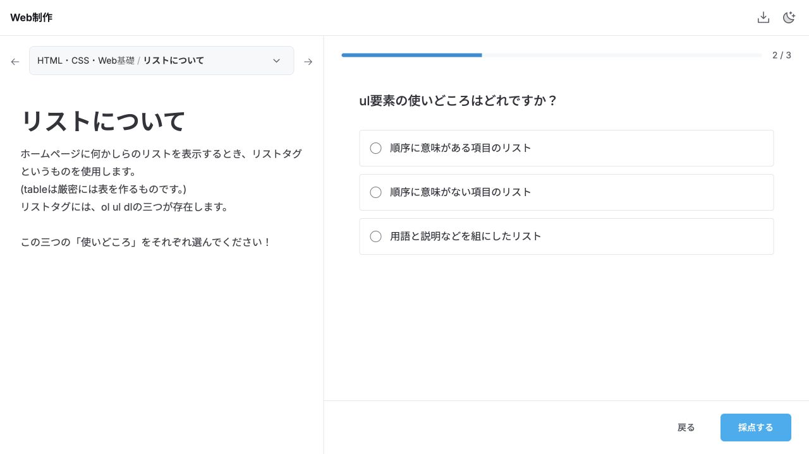

# 自由回答の確認と修正 — 2026-10-18

CSSの役割の問題を選択式へ変更した後に残っていた、短文・自由記述の97設問を対象とした。全設問の問題文・採点条件・回答形式を照合した。対応表をまとめて記述する6設問を分割したため、修正後の対象は119設問になった。

## 修正結果

- 説明・理由・考察を単語一致で判定する形式を廃止し、内容で選べる問題へ変更した。
- 82設問は選択式、37設問は数値・用語・記号・パスなどの入力になった。
- 「順番なしリスト」を誤判定していたulの問題は、順序に意味があるかを選ぶ形式にした。
- A=用語などの一括入力は、用語や番号を1つずつ対応させる設問に分けた。
- 用途から言語名を1つに決めていた問題は、コード例から言語を判別する問題に変更した。
- パスは同じ対象URLへの到達を判定し、ファイル名の大文字・小文字を区別する。
- アンカーの属性はHTMLとして読み、リンク先は前問のidと一致するかを判定する。
- 新しい設問へ旧採点を流用しない。以前の入力内容は保存データに残す。

## 実際の確認

対象の119設問をブラウザーの回答画面から入力し、すべて正解まで進めた。進行に必要な既存設問も回答した。パスの大文字違い、前問と異なるリンク先id、コントラスト不足の白色を意図的に誤答し、修正後の再採点も確認した。

入力形式を残した37設問には、正答の別表記と誤答を合わせて126通りを試した。選択式へ変更した82設問は全選択肢の採点を確認し、正解となる選択肢が各1つであることを確認した。自動テスト57件も通過した。単語一致の採点を一時的に戻すと、回帰テストが失敗することも確認した。

タグを増やす調査では12個のタグを入力し、カードの調査では6枚から8枚に増やした。選択式の回答後も、編集したHTMLが次のCSS修正に引き継がれた。プレビュー付きの3択は1280×720で全選択肢が見えるよう余白を調整した。

途中で、CSSを含まないHTMLがJavaScriptとして表示される不具合も発見した。HTMLファイルとして開くよう修正し、画面でindex.htmlの表示と編集済みコードの保持を確認した。

コントラストの参照ページも開き、「私を読みやすくして！」の背景色が採点条件と同じrgb(137, 253, 248)であることを確認した。引用の問題は、[文化庁の著作権テキスト（令和8年度版）](https://www.bunka.go.jp/seisaku/chosakuken/seidokaisetsu/pdf/94383901_01.pdf)に照らし、画像だけで許諾の有無を断定する問いを避けた。

GAS用ファイルは再生成した。GAS実環境へのデプロイ・動作確認は今回の範囲に含めていない。実行コードの全問題を解き直したという意味でもない。

[回答・採点の詳細記録](free-answer-review.json)

## 設問ごとの確認結果

| 元の設問ID | 元の設問 | 確認・対応 |
| --- | --- | --- |
| quiz-03-answer-1 | ① console.log(8 + 2); コンソールに出力される結果は何でしょう？ | 数値・記号・用語・パスの客観的な入力。許容表記と設問を確認。 |
| quiz-03-answer-2 | ② console.log('8' + '2'); コンソールに出力される結果は何でしょう？ | 数値・記号・用語・パスの客観的な入力。許容表記と設問を確認。 |
| quiz-04-answer-1 | ①の解答(解答例：X=用語) | 4設問へ分割し、対応を選択。自由な書式の一括入力を廃止。 |
| quiz-04-answer-2 | ②の解答(解答例：X=言語名) | 用途だけでは複数言語が該当するため、5つのコード例から言語を判別する選択問題へ変更。 |
| quiz-09-answer-2 | ① このような、リクエストとレスポンスが ずれたタイミングで行われる通信方式のことを、 何通信というでしょう。 | 用語名の入力。一般的な別名・大文字小文字・全半角を確認。 |
| quiz-09-answer-3 | ② JavaScriptを使い、①の通信をして、 コンテンツを表示する手法を アルファベット4文字で、何というでしょう。 | 問いと入力形式を具体化。 |
| quiz-10-answer-2 | ① 「Uncaught ReferenceError: ○○ is not defined」 このエラー文は、つまりどういう内容のエラーでしょうか。 | 選択式へ変更。説明文の単語一致を廃止。 |
| quiz-11-answer-2 | ① 「Uncaught SyntaxError: Unexpected token ':'」 このエラー文は、つまりどういう内容のエラーでしょうか。 | 選択式へ変更。説明文の単語一致を廃止。 |
| quiz-12-answer-3 | ② 「''」で囲んである文字列の中に、 「'」を文字として出したいときの エスケープシーケンスは何でしょう。 | 数値・記号・用語・パスの客観的な入力。許容表記と設問を確認。 |
| quiz-12-answer-4 | ③ バックスラッシュを文字として出したいときの エスケープシーケンスは何でしょう。 | 数値・記号・用語・パスの客観的な入力。許容表記と設問を確認。 |
| quiz-18-answer-2 | ①(画像参照) このプログラムについて、 コンソールには何と表示されるでしょう。 | 問いと入力形式を具体化。 |
| quiz-18-answer-3 | ②(画像参照) このプログラムについて、 結果はどうなるでしょう。 | 選択式へ変更。説明文の単語一致を廃止。 |
| quiz-18-answer-4 | ③ ②が、そのような結果になったのはなぜでしょう。 簡単に教えてください。 | 選択式へ変更。説明文の単語一致を廃止。 |
| quiz-19-answer-2 | ①(画像参照) このプログラムについて、 コンソールには何と表示されるでしょう。 | 問いと入力形式を具体化。 |
| quiz-19-answer-3 | ②(画像参照) このプログラムについて、 結果はどうなるでしょう。 | 選択式へ変更。説明文の単語一致を廃止。 |
| quiz-19-answer-4 | ③ ②が、そのような結果になったのはなぜでしょう。 簡単に教えてください。 | 選択式へ変更。説明文の単語一致を廃止。 |
| quiz-20-answer-2 | ①(画像参照) この 「console.log(x);」 コンソールには何と表示されるでしょう。 | 問いと入力形式を具体化。 |
| quiz-20-answer-3 | ②(画像参照) この 「console.log(x * z);」 コンソールには何と表示されるでしょう。 | 問いと入力形式を具体化。 |
| quiz-20-answer-4 | ③(画像参照) この 「console.log(x * y);」 結果はどうなるでしょう。 | 選択式へ変更。説明文の単語一致を廃止。 |
| quiz-24-answer-2 | ① 文章中の下線部①「関数に渡したい値や変数」 これは何という用語で呼ばれていますか？ | 用語名の入力。一般的な別名・大文字小文字・全半角を確認。 |
| quiz-24-answer-3 | ② 文章中の下線部②「結果の値が返ってきます。」 これは何という用語で呼ばれていますか？ | 用語名の入力。一般的な別名・大文字小文字・全半角を確認。 |
| quiz-31-answer-2 | ① ブラウザのウィンドウ自体を表すオブジェクトの名前はなんでしょう？ | 用語名の入力。一般的な別名・大文字小文字・全半角を確認。 |
| quiz-31-answer-3 | ② ①のプロパティとして存在する、Webページの情報をまとめたオブジェクトはなんでしょう？ | 問いと入力形式を具体化。 |
| quiz-32-answer-2 | ① JavaScriptからWebページのHTML要素を操作するための仕組みのことを、アルファベット3文字で何といいますか？ | 用語名の入力。一般的な別名・大文字小文字・全半角を確認。 |
| quiz-32-answer-3 | ② <body>、<h1>、
といったHTMLタグや、コメント、属性、テキストなどの各オブジェクトのことを、①の仕組みの上では何といいますか？ | 問いと入力形式を具体化。 |
| quiz-35-answer-3 | ② このように、複数の英単語を繋ぐとき、 先頭は小文字で、スペースを空けず、続く単語の頭文字を大文字にする 表記の仕方を何といいますか？ | 数値・記号・用語・パスの客観的な入力。許容表記と設問を確認。 |
| quiz-46-answer-2 | ①(画像参照) この「this」は、何を指しているでしょうか？ | 選択式へ変更。説明文の単語一致を廃止。 |
| quiz-46-answer-3 | ②(画像参照) この「this」は、何を指しているでしょうか？ | 選択式へ変更。説明文の単語一致を廃止。 |
| quiz-46-answer-4 | ③(画像参照) この「this」は、何を指しているでしょうか？ | 選択式へ変更。説明文の単語一致を廃止。 |
| web-05-answer-1 | olタグの説明 | 選択式へ変更。説明文の単語一致を廃止。 |
| web-05-answer-2 | ulタグの説明 | 選択式へ変更。説明文の単語一致を廃止。 |
| web-05-answer-3 | dlタグの説明 | 選択式へ変更。説明文の単語一致を廃止。 |
| web-07-answer-1 | 絶対パス | URLとして解決して採点。同じ対象への別表記を許容し、パスの大文字・小文字は区別。 |
| web-07-answer-2 | 相対パス | URLとして解決して採点。同じ対象への別表記を許容し、パスの大文字・小文字は区別。 |
| web-09-answer-1 | どう表示される？ | 選択式へ変更。説明文の単語一致を廃止。 |
| web-09-answer-2 | どこからどこが間違い？ | 選択式へ変更。説明文の単語一致を廃止。 |
| web-12-answer-1 | ?????の解答 | 選択式へ変更。説明文の単語一致を廃止。 |
| web-12-answer-2 | 何色ですか？ | 選択式へ変更。説明文の単語一致を廃止。 |
| web-13-answer-1 | 解答 | 6設問へ分割し、対応を選択。自由な書式の一括入力を廃止。 |
| web-14-answer-1 | ワイヤーフレームの説明 | 選択式へ変更。説明文の単語一致を廃止。 |
| web-14-answer-2 | モックアップの説明 | 選択式へ変更。説明文の単語一致を廃止。 |
| web-14-answer-3 | この作業をなんという？ | 選択式へ変更。説明文の単語一致を廃止。 |
| web-15-answer-1 | 解答欄 | 7設問へ分割し、対応を選択。自由な書式の一括入力を廃止。 |
| web-17-answer-1 | staff.jsの相対パス | URLとして解決して採点。同じ対象への別表記を許容し、パスの大文字・小文字は区別。 |
| web-17-answer-2 | staff.jpgの相対パス | URLとして解決して採点。同じ対象への別表記を許容し、パスの大文字・小文字は区別。 |
| web-20-answer-1 | 一つ目の解答 | 4設問へ分割し、対応を選択。自由な書式の一括入力を廃止。 |
| web-20-answer-2 | 二つ目の解答 | 長さごとの数値入力へ分割。単位pxの有無を許容。 |
| web-22-answer-1 | 記述ルールの解答 | 選択式へ変更。説明文の単語一致を廃止。 |
| web-22-answer-2 | 複数指定の理由 | 選択式へ変更。説明文の単語一致を廃止。 |
| web-26-answer-1 | ①の解答 | 数値・記号・用語・パスの客観的な入力。許容表記と設問を確認。 |
| web-26-answer-2 | ②の解答 | 数値・記号・用語・パスの客観的な入力。許容表記と設問を確認。 |
| web-26-answer-3 | ③の解答 | 数値・記号・用語・パスの客観的な入力。許容表記と設問を確認。 |
| web-29-answer-1 | 「box-sizing: content-box;」について 理解していることを記述してください。 | 選択式へ変更。説明文の単語一致を廃止。 |
| web-29-answer-2 | 「box-sizing: border-box;」について 理解していることを記述してください。 | 選択式へ変更。説明文の単語一致を廃止。 |
| web-35-answer-1 | 解答 | 選択式へ変更。説明文の単語一致を廃止。 |
| web-36-answer-1 | ①は、どれが適していると思うか 教えてください。 | 選択式へ変更。説明文の単語一致を廃止。 |
| web-36-answer-2 | ②は、どれが適していると思うか 教えてください。 | 選択式へ変更。説明文の単語一致を廃止。 |
| web-36-answer-3 | ③は、どれが適していると思うか 教えてください。 | 選択式へ変更。説明文の単語一致を廃止。 |
| web-37-answer-1 | ①以下のCSSのとき、赤い箱(.box)の横幅はいくつ？ | 数値・記号・用語・パスの客観的な入力。許容表記と設問を確認。 |
| web-37-answer-2 | ② 以下のCSSのとき、赤い箱(.box)の横幅はいくつ？ | 数値・記号・用語・パスの客観的な入力。許容表記と設問を確認。 |
| web-37-answer-3 | ③ 以下のCSSのとき、「クイズ第３７問！」の文字の大きさはいくつ？ | 数値・記号・用語・パスの客観的な入力。許容表記と設問を確認。 |
| web-38-answer-2 | ② h2タグに追加する属性 | HTMLとしてid属性を検証。引用符なし・日本語・数字始まりの有効なidも許容。 |
| web-38-answer-3 | ③ リンク先のURL | 前問のidとURLフラグメントの一致を検証。異なるidでは正解にしない。 |
| web-43-answer-1 | ①CSSが指定してあります。 「【１】ここの文字は何色？」の文字は 何色でしょう？ | 選択式へ変更。説明文の単語一致を廃止。 |
| web-43-answer-2 | ② 「【２】この箱の背景色は何色？」の 背景色は何色でしょう？ | 選択式へ変更。説明文の単語一致を廃止。 |
| web-46-answer-1 | ① 「【１】この箱の背景色は？」のところ 背景色をお答えください。 | 選択式へ変更。説明文の単語一致を廃止。 |
| web-46-answer-2 | ② 「【２】この箱の背景色は？」のところ 背景色をお答えください。 | 選択式へ変更。説明文の単語一致を廃止。 |
| web-46-answer-3 | ③ 「【３】この文の文字色は？」のところ 文字の色をお答えください。 | 選択式へ変更。説明文の単語一致を廃止。 |
| web-47-answer-1 | ①(画像参照) この数値を変更すると、どう色が変わりますか？ | 選択式へ変更。説明文の単語一致を廃止。 |
| web-47-answer-2 | ②(画像参照) この数値を変更すると、どう色が変わりますか？ | 選択式へ変更。説明文の単語一致を廃止。 |
| web-47-answer-3 | ③(画像参照) この数値を変更すると、どう色が変わりますか？ | 選択式へ変更。説明文の単語一致を廃止。 |
| web-57-answer-1 | ① テキスト内容を書き換えて、 どの点が問題と思ったか、 簡単に教えてください。 | 選択式へ変更。説明文の単語一致を廃止。 |
| web-58-answer-1 | ① タグの部分、 これを増やしたとき、問題が起こります。 どのような問題か、簡単に教えてください。 | 選択式へ変更。説明文の単語一致を廃止。 |
| web-59-answer-1 | ① カード(<li>~</li>の部分) これを増やしたとき、問題が起こります。 どのような問題か、簡単に教えてください。 | 選択式へ変更。説明文の単語一致を廃止。 |
| web-62-answer-1 | ①問題点を教えてください。 | 選択式へ変更。説明文の単語一致を廃止。 |
| web-62-answer-2 | ②このようなことを、 俗に何と言いますか？ | 問いと入力形式を具体化。 |
| web-63-answer-1 | ①この記事の問題点を教えてください。 | 選択式へ変更。説明文の単語一致を廃止。 |
| web-63-answer-2 | ②どのような場合に、 他者の著作物を掲載することができるのでしょうか？ | 選択式へ変更。説明文の単語一致を廃止。 |
| web-64-answer-2 | ② 一番下の「私を読みやすくして！」の文字、 これの文字色が、コントラスト比4.5以上になる カラーコードを教えてください。 | 問いと入力形式を具体化。 |
| web-65-answer-1 | ①(画像参照) 赤丸で囲った部分、 これを何と言いますか？ | 数値・記号・用語・パスの客観的な入力。許容表記と設問を確認。 |
| web-65-answer-2 | ②(画像参照) ①のような飾りのある書体のことを 何と言いますか？ | 数値・記号・用語・パスの客観的な入力。許容表記と設問を確認。 |
| web-65-answer-3 | ③(画像参照) ①のような飾りがない書体のことを 何と言いますか？ | 数値・記号・用語・パスの客観的な入力。許容表記と設問を確認。 |
| web-66-answer-3 | ③ 実際に駅で使われているのは①のほうです。 これはなぜだと思いますか？ 簡単に考察を教えてください！ | 選択式へ変更。説明文の単語一致を廃止。 |
| web-67-answer-1 | ①(画像参照) なんという名前のフォントでしょう？ | 書体名を選択する形式へ変更。画像内の左側の見本文字を対象に明記。 |
| web-67-answer-2 | ②(画像参照) なんという名前のフォントでしょう？ | 書体名を選択する形式へ変更。画像内の左側の見本文字を対象に明記。 |
| web-67-answer-3 | ③(画像参照) なんという名前のフォントでしょう？ | 書体名を選択する形式へ変更。画像内の左側の見本文字を対象に明記。 |
| web-68-answer-1 | ① imgタグ(HTML)は、どんなときに使いますか？ | 選択式へ変更。説明文の単語一致を廃止。 |
| web-68-answer-2 | ② background-image(CSS)は、どんなときに使いますか？ | 選択式へ変更。説明文の単語一致を廃止。 |
| web-69-answer-1 | ①(画像参照) 画像と画像の説明文を書きました。 しかし、画像に対して、 どの文がそれを説明しているのかがわかりにくいです。 なぜでしょう？ | 選択式へ変更。説明文の単語一致を廃止。 |
| web-69-answer-2 | ② こうならないためには、 どのようなことを意識するべきですか？ | 選択式へ変更。説明文の単語一致を廃止。 |
| web-70-answer-2 | ② 1920×1080ピクセル などというときの、 「ピクセル」って何のことですか？ | 選択式へ変更。説明文の単語一致を廃止。 |
| web-70-answer-3 | ③ 4000×3000ピクセルの写真があったとき、 これの「画素数」はいくつですか？ | 数値と万画素の表記、桁区切りを許容。 |
| web-71-answer-1 | ①(画像参照) なんという名前のフォントでしょう？ | 書体名を選択する形式へ変更。画像内の左側の見本文字を対象に明記。 |
| web-71-answer-2 | ②(画像参照) なんという名前のフォントでしょう？ | 書体名を選択する形式へ変更。画像内の左側の見本文字を対象に明記。 |
| web-71-answer-3 | ③(画像参照) なんという名前のフォントでしょう？ | 書体名を選択する形式へ変更。画像内の左側の見本文字を対象に明記。 |
| web-75-answer-1 | 「.mp4」 これは何のファイルですか？ | 選択式へ変更。説明文の単語一致を廃止。 |
| web-75-answer-2 | 「.docx」 これは何のファイルですか？ | 選択式へ変更。説明文の単語一致を廃止。 |

## 前段の説明の復元 — 2026-10-18

回答形式の変更時に短縮・削除していた前段を、13問で元のフォームから復元した。解説の段落を残し、「説明を書いてください」などの指示を現在の選択式に合わせた。エディタに移した初期コードや、画面内の実習へ置き換えた外部サイトの案内は戻していない。

13問すべてで、復元した文章が実画面に表示されることを確認した。リストの問題では、その説明を表示したまま採点し、次の設問へ進めることも確認した。

[復元前後の記録](intro-restoration-review.json)

