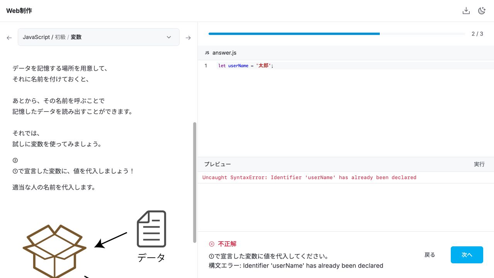
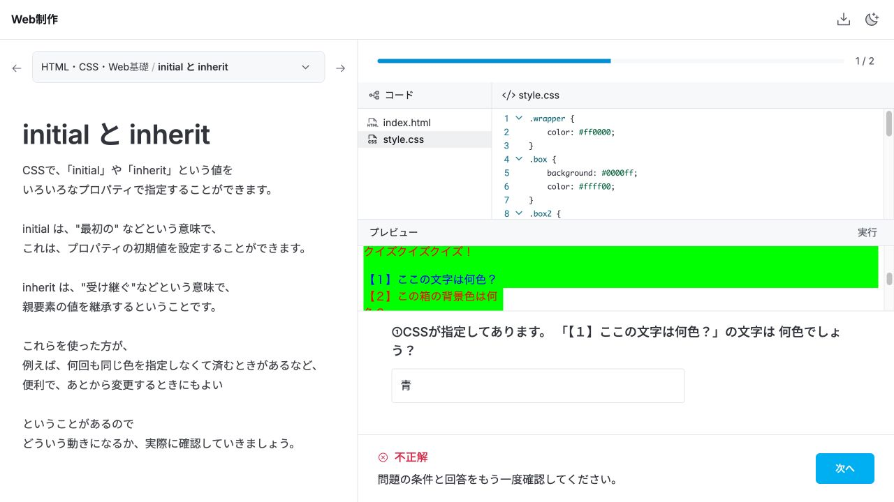
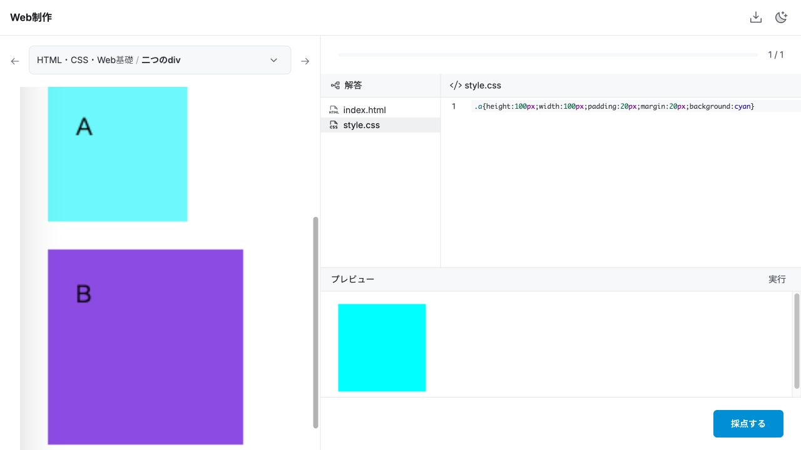
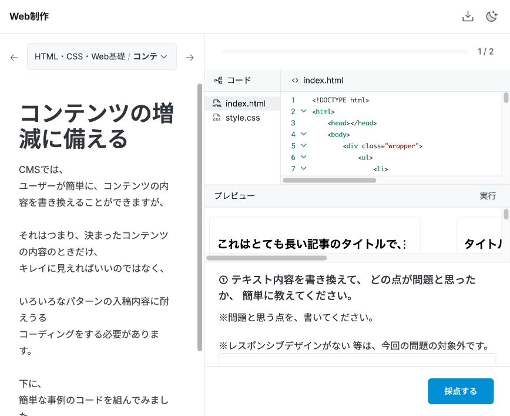

# 演習画面の体験確認 — 2026-10-17

初回は10問・18設問を、別の保存領域で未回答の状態から解いた。解答例や採点条件は参照せず、画面にある問題文・コード・画像を読んで入力し、実行・採点・次の設問への移動まで確認した。18設問とも最終的には正解したが、途中に以下の支障があった。

その後、下記の不具合を修正し、同じ10問・18設問を新しい保存領域で解き直した。修正後の確認結果は末尾に記載する。

## 優先して直す問題

### 1. エディタにないコードが実行・採点される

「変数」①で `let userName;` と宣言し、②へ進むとエディタは空になる。そこで `let userName = '太郎';` と画面上で完結したコードを書くと、実行も採点も二重宣言エラーになる。前問の宣言が見えない状態で連結されている。代入だけの `userName = '太郎';` に書き直すと正解した。

学習者は、エディタの内容と実行されるプログラムが一致するという前提で読めない。

### 2. 問題を調べた状態が、修正する設問に引き継がれない

「コンテンツの増減に備える」①でタイトルを長くし、三点メニューと文字が重なることを確認した。その内容を記述して正解後、②のCSS修正へ進むとタイトルは元の短い文に戻った。修正前後を比べるため、長いタイトルをもう一度入力する必要があった。

### 3. 編集できる参照コードと採点対象が一致しない

「initial と inherit」で `.text4` の `color: initial` を `color: blue` に変更して実行すると、対象の文字は青くなる。その表示どおり「青」と回答しても不正解。元のコードに戻し「黒」と回答すると正解した。

コードを試せることと、元の問題を採点することの境界が画面にない。参照コードを編集した後に、元に戻す操作も見当たらなかった。

### 4. 比較するはずのBが初期コードに存在しない

「二つのdiv」は画像のAとBを比較する問題だが、HTMLには空の `.a` だけがあり、BもA/Bの文字もない。プレビューはラベルのない水色の箱一つなので、見本との対応が分かりにくい。

## 表示と学習の流れの問題

- **参照先が前の画面に消える。** 「データ型」③は「②のデータ型」を問うが、②の式は表示されない。確認には「戻る」が必要になる。
- **設問が問うファイルが最初に開かない。** 「calc関数」では「以下のCSS」と言う一方、最初に表示されるのはHTML。条件の式は `style-2.css` にあり、共通設定は `style.css` にある。次の設問でもHTMLに戻り、探し直す。
- **画面を分割しすぎて、観察対象と解答欄が見えない。** 1280×720では「initial と inherit」のプレビューは最初に見出し程度しか表示されない。「コンテンツの増減に備える」①は注意書きに押されて解答欄が下に隠れる。説明・コード・プレビュー・解答欄で別々にスクロールが発生する。
- **不正解後も主ボタンが「次へ」になる。** 「変数」の二重宣言エラーと「initial と inherit」の誤答で確認した。直す前に先へ進める状態になり、再挑戦が主導線にならない。
- **誤答の理由を説明しない。** 「initial と inherit」では「問題の条件と回答をもう一度確認してください。」だけで、表示と採点対象の違いを判断できない。
- **最初の課題の完成形が画像にしかない。** 「はじめてのJavaScript」は、参考画像を開いて初めて `Hello World!` を表示する想定だと分かる。本文はブラウザーの開発者ツールを使う説明のままで、画面内の実行環境との対応も分かりにくい。
- **小さい画像の「拡大」が縮小になる。** 「二つのdiv」では、本文で大きく表示されていた比較画像が、拡大ダイアログでは小さい元画像の寸法になった。

## 実際に解いた問題

| 問題 | 設問数 | 操作・結果 |
| --- | ---: | --- |
| JS 1 はじめてのJavaScript | 1 | 画像を確認し、文字列を出力。実行・採点で正解 |
| JS 2 かんたんな計算をしてみよう | 1 | 四則演算の4出力を実行・採点。正解 |
| JS 3 データ型 | 3 | 10、82、文字列を回答。全問正解。前問参照の欠落を確認 |
| JS 6 変数 | 3 | 宣言・代入・出力。二重宣言で不正解後、代入のみへ変更して全問正解 |
| JS 8 コメント | 1 | 体重・身長・BMI計算のコメントを追加。70と1.7で実行し、採点も正解 |
| Web 3 FORM / HTML初級編 | 1 | IDをhidden、メール欄をemail・name=mailに変更。正解 |
| Web 24 二つのdiv | 1 | Aへbox-sizingを追加。正解。比較対象の欠落を確認 |
| Web 37 calc関数 | 3 | 式と共通CSSを読み、300px、380px、20pxを回答。全問正解 |
| Web 43 initial と inherit | 2 | 参照CSSの編集・実行と誤答を確認後、元の条件で黒・緑を回答。全問正解 |
| Web 57 コンテンツの増減に備える | 2 | 長いタイトルで重なりを再現・記述。次問でタイトルを入れ直し、右余白を追加して正解 |

[入力した回答と採点結果](screenshots/walkthrough/answers.json)

## 修正後の解き直し — 2026-10-17

上記と同じ10問・18設問を画面から入力し、すべて正解まで進めた。単に正答が通ることに加え、初回に支障が出た操作を繰り返した。

| 初回の支障 | 修正と画面で確認した結果 |
| --- | --- |
| 見えない前問コードによる二重宣言 | 変数②に前問の宣言が表示される。全文を `let userName = '太郎';` に書き換えて実行・採点が通り、③にも全文が引き継がれた |
| 調査したHTMLが次問で戻る | Web57①で長くしたタイトルが②のHTMLに残る。再入力せずCSSの右余白を追加し、採点が通った |
| 表示と採点対象が食い違う | 出力・色を予測する問題の参照コードは読み取り専用にした。calcのコードをキー入力で変更しようとしても内容は変わらず、表示条件と採点条件が一致した |
| 編集した参照を戻せない | 編集が課題のWeb57ではHTMLから開く。「元に戻す」で初期の短いタイトルに戻り、再編集もできた |
| 比較対象Bとラベルが欠落 | A/Bの両方とラベルがプレビューに表示される。Aへbox-sizingを追加して正解した |
| 前画面の式を参照できない | データ型③に対象の式が表示され、戻らずに回答できた |
| 必要なCSSを探し直す | calcの各設問で、その設問の式があるstyle-2.cssから開いた。300px・380px・20pxで正解した |
| プレビューと入力欄が狭い | 参照コードは「コード／プレビュー」で切り替える。1280×720でinitial/inheritの対象表示と解答欄が同時に見えた。Web57の解答欄も注意書きに隠れなかった |
| 誤答で「次へ」が主導線になる | データ型とinitial/inheritを意図的に誤答し、「もう一度採点する」が表示され、「次へ」がないことを確認。修正して再採点すると正解になった |
| 誤答時の案内が抽象的 | データ型では引用符と+演算子、initial/inheritでは自身の指定と親からの継承を確認する案内が表示された |
| Hello Worldの目標が画像にしかない | 本文に出力すべき文字列を明記。別の文字列は不正解、Hello World!は実行・採点とも通った。計算問題も画面内の実行環境に合わせた文面で解けた |
| 画像の拡大が縮小になる | Web24で本文の画像幅433pxに対し、拡大後は768pxになった。マウス操作とキーボード操作で閉じられた |

JS08では70と1.7を入力してBMIの実行結果を確認し、コメント追加の採点も通った。Web03ではID欄をhidden、メール欄をemail・name=mailへ変更し、プレビューと採点が通った。

自動テストは52件、ブラウザーでの描画・採点検証は57件が成功した。GASへ配置するファイルも生成したが、GAS実環境での動作は今回の確認範囲に含まない。今回実際に解いた範囲は上記10問であり、残りの全問題を解いたという意味ではない。

- [参照プレビューと解答欄](screenshots/walkthrough-fixed/reference-layout.jpg)
- [全文コードの実行・採点](screenshots/walkthrough-fixed/complete-program.jpg)
- [A/Bの比較表示](screenshots/walkthrough-fixed/comparison.jpg)
- [調査内容の引き継ぎ](screenshots/walkthrough-fixed/carried-source.jpg)
- [画像の拡大表示](screenshots/walkthrough-fixed/image-zoom.jpg)
